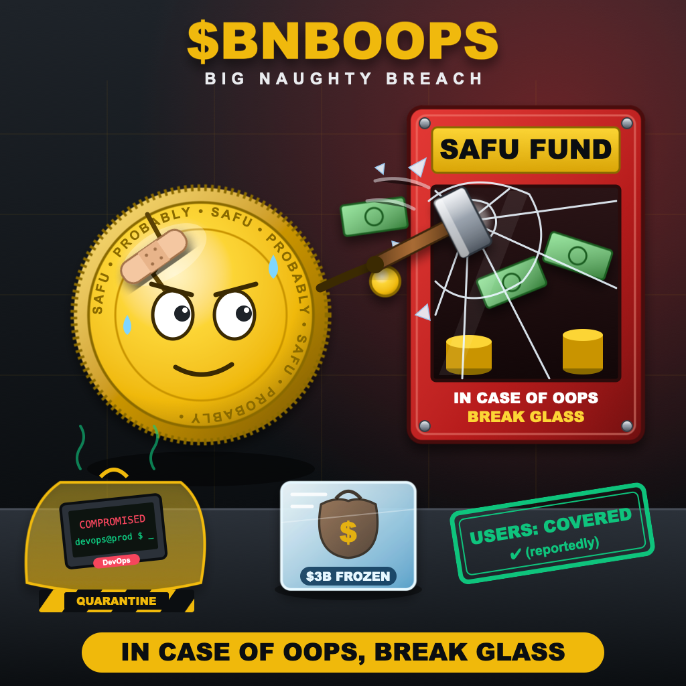
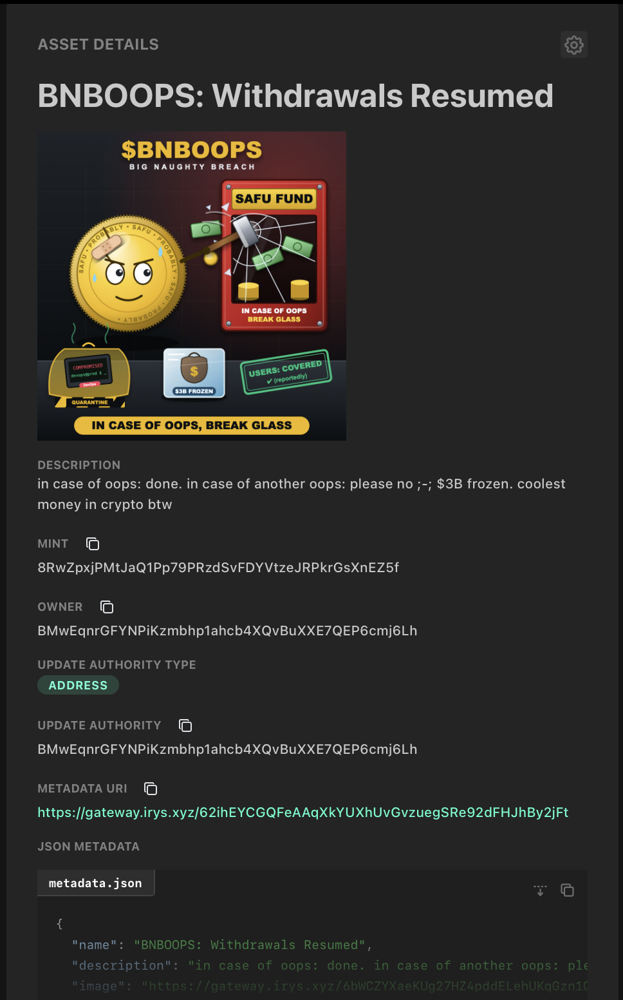

# $BNBOOPS: Big Naughty Breach

A parody SPL token and MPL Core NFT on Solana **devnet**, made the day after the Oct 2026 Binance hack.
In case of oops, break glass.

📝 Write-up: [Who Actually Controls a Solana Token?](https://medium.com/@imahelika/who-actually-controls-a-solana-token-5a82e94fbcae)



## What I built

1. **SPL token**: created a mint, attached Metaplex metadata, minted 1,000,000 BNBOOPS and sent 100,000 to a second wallet.
2. **MPL Core NFT**: uploaded the art and metadata to Irys and minted *"BNBOOPS: Withdrawals Paused"*.
3. **Update**: as the update authority, renamed it to *"BNBOOPS: Withdrawals Resumed"* and swapped its metadata.

| | Before | After |
|---|---|---|
| Name | Withdrawals Paused | Withdrawals Resumed |
| Status | Investigating | SAFU-ish |
| Withdrawals | Paused | Resumed |
| Laptop | Compromised | Quarantined |
| 4th trait | Loot: $3B Frozen | Users: Covered |



## On-chain

| Step | Transaction |
|---|---|
| Create mint | [5H1cCM…](https://explorer.solana.com/tx/5H1cCM5s4xVoHRFRT3DqobgUfgNaRcM75QmDjyZgoDAGjNo3Ge9hHtJBhSNpXSVvzQ6YFvntnGN6Bo1LX6P6jHkr?cluster=devnet) |
| Token metadata | [2kRoeE…](https://explorer.solana.com/tx/2kRoeEisrHR9vRoz75LESryWgAGqu2vdtaWBm7qdbyQZH9ac23DMm4QQXvcswWnQqWHFPQovbWiLvBT5E7zzcfv2?cluster=devnet) |
| Mint 1M BNBOOPS | [5Ww22M…](https://explorer.solana.com/tx/5Ww22Mgk7BEsH8T1rv4W8f5VUyDeoZe68BDg1x7VurCefPJZc8tPTZ3sr71xFcULuRg1nrKYZManYoTSZVARFXRP?cluster=devnet) |
| Transfer 100K BNBOOPS | [V8QietF…](https://explorer.solana.com/tx/V8QietFV91sZTegKhkYmeA1zMBMMksEteqG3PKpT55f7PUcpUpq6rxA3M1K2WYFYWaE5zF3vtdo8mvPFaTxYB4p?cluster=devnet) |
| Mint NFT | [gQuwAB…](https://explorer.solana.com/tx/gQuwABBPnmcmh6LhgJsS97Sde7MZJou4WiKqHC8U2by4c3NWsDBCyoktziKhQTSFZzk5bitgMTZqTE4Wgob6kK3?cluster=devnet) |
| Update NFT | [3tgAkV…](https://explorer.solana.com/tx/3tgAkVH3EAJhLZ8bt9ac4amZAof6x1GCzov231Z3pMvPNiTejwhd528PPEb5o4mHV1g75oSWthkex4Tsd6qUF2yQ?cluster=devnet) |

- Token mint: [`EF8CeLCEfaEPRVEWxy671sDQXVNX2ehykv4re4y9ds7M`](https://explorer.solana.com/address/EF8CeLCEfaEPRVEWxy671sDQXVNX2ehykv4re4y9ds7M?cluster=devnet)
- NFT: [`8RwZpxjPMtJaQ1Pp79PRzdSvFDYVtzeJRPkrGsXnEZ5f`](https://core.metaplex.com/explorer/8RwZpxjPMtJaQ1Pp79PRzdSvFDYVtzeJRPkrGsXnEZ5f?env=devnet)
- Creator: `BMwEqnrGFYNPiKzmbhp1ahcb4XQvBuXXE7QEP6cmj6Lh`, holds 900,000 BNBOOPS and the NFT
- Recipient: `AcFFMp6V1B8ubNer5ziVPVQ56dTTUm4Xzm2ZGp9TTFPb`, holds 100,000 BNBOOPS

## Run it

```bash
npm install
# put a funded devnet keypair at ./devnet-wallet.json
npm run spl:init        # paste the mint address into the next scripts
npm run spl:metadata
npm run spl:mint
npm run spl:transfer
npm run nft:image       # paste each URI/address into the next script
npm run nft:metadata
npm run nft:mint
npm run nft:update
```

## What I learned

- **A mint isn't tokens.** It only holds the rules (decimals, who can mint). Supply is 0 until you call `mintTo`, and every holder needs their own associated token account (a PDA from wallet + token program + mint).
- **Metadata lives in two places.** Name, symbol and URI are on-chain. The image and traits are a JSON file on Irys that the URI points to.
- **A Core NFT is one account.** Owner, update authority, name and URI all sit in a single account, instead of the legacy mint + token account + metadata account.
- **Updates are public history.** Explorers usually show the latest metadata, but the update transactions stay on-chain. Old JSON files stay reachable only as long as their storage keeps them.
- **Control comes down to who can sign.** Owning the NFT doesn't stop the update authority from rewriting it. The Binance hack was a different system entirely, but it raised the same question: who is authorized to sign?

Built with `@solana/kit`, `@solana-program/token`, Metaplex Umi, Token Metadata, MPL Core and Irys.
